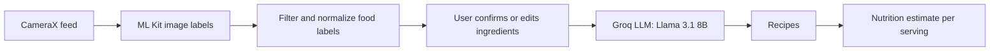

# SeeFood

Point your phone at your fridge and get recipes.

SeeFood is an Android app that recognizes ingredients from a live camera feed, generates recipes from them with an LLM, and tracks nutrition against your daily goals. It was built as a team project for UW-Madison CS 407 (Fall 2025).

## Screenshots

<!-- TODO: add screenshots to docs/screenshots/ -->

| Scan | Confirm | Recipes | Nutrition |
| --- | --- | --- | --- |
|  |  |  |  |

## Features

- **Live ingredient recognition**: on-device ML Kit image labeling runs on the CameraX feed. Labels are filtered down to food items and normalized, and the user can confirm or edit the list before generating recipes.
- **LLM recipe generation**: confirmed ingredients are sent to Llama 3.1 8B via the Groq API, which returns structured JSON recipes. If no API key is set or the response can't be parsed, the app falls back to sample recipes.
- **Nutrition tracking**: per-serving estimates for calories, protein, carbs and fat, logged against daily goals you set.
- **Saved recipes**: save recipes to revisit later.
- **Accounts**: Firebase email/password login and signup, with user data stored in Firestore.
- **Daily reminders**: scheduled notifications via WorkManager.

## Tech stack

- Kotlin, Jetpack Compose (Material 3), Navigation Compose
- CameraX
- Google ML Kit (image labeling)
- Groq API (Llama 3.1 8B) over OkHttp, with kotlinx.serialization
- Firebase Authentication and Cloud Firestore
- Jetpack DataStore
- WorkManager

## How it works



## Setup

1. Clone the repo and open it in Android Studio.

   ```bash
   git clone https://github.com/aahaan04/SeeFood.git
   ```

2. Add your Groq API key to `local.properties` in the project root (this file is gitignored):

   ```properties
   GROQ_API_KEY=your_key
   ```

   Without a key, the app still runs and shows sample recipes.

3. Create a Firebase project with Authentication (email/password) and Firestore enabled, then replace `app/google-services.json` with your own.

4. Run on an emulator or a physical device (minSdk 26).

## Project structure

```
app/src/main/java/com/cs407/seefood/
├── data/           # Groq LLM client, repository, DataStore for daily goals
├── ml/             # ML Kit ingredient analyzer and label filtering
├── model/          # Recipe and NutritionInfo models
├── notifications/  # Daily reminder worker
└── ui/             # Compose screens, navigation, camera preview, ViewModel
```

## Team

- [Aahaan Sheth](https://github.com/aahaan04) (also committed as [aahaan2904](https://github.com/aahaan2904)): authentication, computer vision pipeline, LLM recipe generation
- [Anay Baheti](https://github.com/anaybaheti)
- [Darshil Kedia](https://github.com/darshilkedia)
- [avitamotia](https://github.com/avitamotia)
